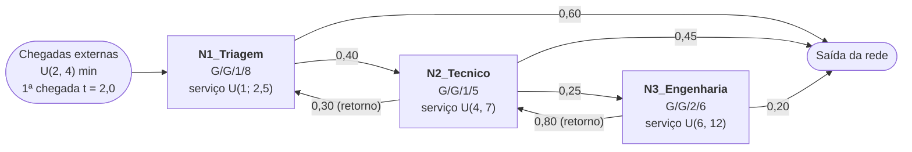
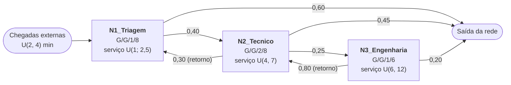

# Trabalho 2 — Análise de uma Central de Suporte de TI por Simulação

Disciplina: Métodos Analíticos (PUCRS)
Simulador utilizado: [`t2_simulador.py`](t2_simulador.py) (validado contra o `simulator.jar` do módulo M3, ver Seção 7)

---

## 1. Problemática

Uma empresa mantém uma **central de suporte de TI** organizada em três níveis. Todo
chamado aberto por um usuário entra pela triagem e pode ser escalado, devolvido ou
encerrado em cada nível:

| Nível | Fila | Função | Equipe atual |
|---|---|---|---|
| N1 | `N1_Triagem` | *Service desk*: registra o chamado, resolve problemas simples (senha, acesso, dúvidas) ou escala para o N2 | 1 atendente |
| N2 | `N2_Tecnico` | Suporte técnico: diagnostica e corrige problemas de estação, software e rede local | 1 técnico |
| N3 | `N3_Engenharia` | Engenharia/infraestrutura: servidores, banco de dados, falhas complexas | 2 engenheiros |

Fluxo dos chamados (todos os tempos em **minutos**):

- Chamados chegam do exterior ao N1 a cada **2 a 4 min** (uniforme). O primeiro chega no instante 2,0.
- **N1** atende em **1 a 2,5 min**. **40%** dos chamados são escalados ao N2; os outros **60%** são resolvidos e saem.
- **N2** atende em **4 a 7 min**. Após o atendimento:
  - **30%** **retornam ao N1** (o técnico devolve o chamado à triagem para contato com o usuário, coleta de informações ou validação da solução);
  - **25%** são escalados ao N3;
  - **45%** são resolvidos e saem.
- **N3** atende em **6 a 12 min**. **80%** **retornam ao N2** (a engenharia corrige a causa, mas o técnico precisa aplicar/testar a solução na máquina do usuário); **20%** são encerrados direto pelo N3.
- As filas têm capacidade limitada pelo sistema de chamados (número máximo de chamados abertos por nível): N1 = 8, N2 = 5, N3 = 6. Um chamado que chega a um nível lotado é **perdido** (o usuário desiste / o chamado expira).

A rede **não é tandem**: há dois retornos (N2 → N1 e N3 → N2), de modo que um
mesmo chamado pode passar várias vezes pelas filas.

---

## 2. Modelo da rede de filas

### 2.1 Desenho da rede



Versão em texto (para impressão):

```
                                 0,30 (retorno)
              ┌──────────────────────────────────────────┐
              ▼                                          │
  U(2,4) ──►┌───────────────┐   0,40   ┌───────────────┐ │  0,25   ┌────────────────┐
  t0 = 2,0  │  N1_Triagem   │─────────►│  N2_Tecnico   │─┴───────►│ N3_Engenharia  │
            │   G/G/1/8     │          │   G/G/1/5     │◄─────────│   G/G/2/6      │
            │ serv U(1;2,5) │          │ serv U(4,7)   │   0,80   │ serv U(6,12)   │
            └───────┬───────┘          └───────┬───────┘ (retorno)└───────┬────────┘
                    │ 0,60                     │ 0,45                     │ 0,20
                    ▼                          ▼                          ▼
                  saída                      saída                      saída
```

### 2.2 Parâmetros (notação de Kendall A/B/c/K)

| Fila | Kendall | Servidores | Capacidade | Chegada externa | Atendimento | Roteamento após atendimento |
|---|---|---|---|---|---|---|
| N1_Triagem | G/G/1/8 | 1 | 8 | U(2, 4) | U(1; 2,5) | N2: 0,40 · saída: 0,60 |
| N2_Tecnico | G/G/1/5 | 1 | 5 | — | U(4, 7) | N1: 0,30 · N3: 0,25 · saída: 0,45 |
| N3_Engenharia | G/G/2/6 | 2 | 6 | — | U(6, 12) | N2: 0,80 · saída: 0,20 |

Arquivo do modelo: [`t2_modelo.yml`](t2_modelo.yml).

### 2.3 Parâmetros da simulação

- Filas vazias no início; primeira chegada em t = 2,0.
- **100.000 números pseudoaleatórios por execução** (gerador congruente linear).
- **5 execuções** com sementes 1, 2, 3, 4 e 5; todos os valores reportados são a **média** das 5 execuções.

---

## 3. Verificação analítica preliminar (equações de tráfego)

Antes de simular, as equações de tráfego indicam a carga esperada em cada fila
(ignorando perdas). Com λ₀ = 1/3 cliente/min (média de U(2,4) = 3 min):

```
λ1 = λ0 + 0,30·λ2
λ2 = 0,40·λ1 + 0,80·λ3
λ3 = 0,25·λ2
```

Resolvendo: λ₂ = 0,5·λ₁ → λ₁ = (1/3) / 0,85.

| Fila | λ (cli/min) | E[S] (min) | c | ρ = λ·E[S] / c |
|---|---|---|---|---|
| N1_Triagem | 0,3922 | 1,75 | 1 | 0,686 |
| N2_Tecnico | 0,1961 | 5,50 | 1 | **1,078** |
| N3_Engenharia | 0,0490 | 9,00 | 2 | 0,221 |

O N2 tem **ρ > 1**: o técnico recebe mais trabalho do que consegue atender.
Como a capacidade é finita, a fila não cresce indefinidamente; em vez disso ela
fica quase sempre cheia e **perde chamados**. Já os engenheiros do N3 ficam
ociosos a maior parte do tempo. A simulação confirma isso.

---

## 4. Resultados da simulação — Modelo atual

Comando: `python T2/t2_simulador.py T2/t2_modelo.yml`
Tempo médio simulado: **65.510,8 min**.

### 4.1 Distribuição de probabilidades dos estados

**N1_Triagem (G/G/1/8)**

| Estado | Tempo acumulado | Probabilidade |
|---:|---:|---:|
| 0 | 21.452,30 | 32,75% |
| 1 | 38.041,93 | 58,07% |
| 2 | 5.903,96 | 9,01% |
| 3 | 110,35 | 0,17% |
| 4 | 2,22 | 0,00% |
| 5 | 0,06 | 0,00% |
| 6–8 | 0,00 | 0,00% |

Perdas: **0**

**N2_Tecnico (G/G/1/5)**

| Estado | Tempo acumulado | Probabilidade |
|---:|---:|---:|
| 0 | 4.265,29 | 6,51% |
| 1 | 9.838,42 | 15,02% |
| 2 | 12.388,32 | 18,91% |
| 3 | 14.230,88 | 21,72% |
| 4 | 16.176,40 | 24,70% |
| 5 | 8.611,50 | **13,15%** |

Perdas: **1.141,8 chamados por execução** (9,29% dos chamados que chegam ao N2)

**N3_Engenharia (G/G/2/6)**

| Estado | Tempo acumulado | Probabilidade |
|---:|---:|---:|
| 0 | 42.935,80 | 65,54% |
| 1 | 20.203,72 | 30,84% |
| 2 | 2.336,07 | 3,57% |
| 3 | 35,22 | 0,05% |
| 4–6 | 0,00 | 0,00% |

Perdas: **0**

### 4.2 Índices de desempenho

Fórmulas usadas (a partir da distribuição P(n) e do tempo total T):

- População: N = Σ n·P(n); na fila de espera Nq = Σ (n − c)·P(n), para n > c
- Utilização: U = Σ min(n, c)·P(n) / c
- Vazão: X = atendimentos concluídos / T
- Tempo de resposta (Lei de Little): W = N / X; espera na fila Wq = Nq / X

| Fila | U | X (cli/min) | N | Nq | W (min) | Wq (min) | Perdas |
|---|---:|---:|---:|---:|---:|---:|---:|
| N1_Triagem | 67,25% | 0,3840 | 0,766 | 0,094 | 1,995 | 0,244 | 0 |
| N2_Tecnico | **93,49%** | 0,1702 | **2,825** | **1,890** | **16,597** | **11,105** | **1.141,8** |
| N3_Engenharia | 19,04% | 0,0423 | 0,381 | 0,001 | 9,016 | 0,013 | 0 |

**Rede completa**

| Índice | Valor |
|---|---:|
| Chegadas externas por execução | 21.840,2 |
| Chamados perdidos | 1.141,8 (**5,23%** de todos os chamados abertos) |
| População média na rede (N) | 3,973 |
| Vazão de saída da rede (chamados resolvidos/min) | 0,3159 |
| Tempo médio de permanência na rede (W = N / λ aceito) | **11,92 min** |

### 4.3 Identificação do gargalo

- **N2_Tecnico é o gargalo.** O técnico está ocupado 93,5% do tempo e a fila está
  **cheia em 13,15% do tempo**, o que faz 9,3% dos chamados que chegam ao N2
  (vindos do N1 e devolvidos pelo N3) serem perdidos. Um chamado escalado fica,
  em média, **11,1 min só esperando** e 16,6 min no total no N2 — mais que o dobro
  do próprio tempo de atendimento (5,5 min).
- O gargalo é agravado pelos retornos: 80% dos chamados do N3 voltam ao N2,
  então o N2 recebe tanto os escalonamentos do N1 quanto o retrabalho do N3.
- **N3_Engenharia está superdimensionado.** Os dois engenheiros ficam ociosos
  81% do tempo; em 65,5% do tempo não há nenhum chamado no N3 e quase nunca há
  espera (Wq ≈ 0,01 min).
- **N1_Triagem** está bem dimensionado (U = 67%, Wq = 0,24 min, sem perdas).

---

## 5. Modelo com melhorias

### 5.1 Proposta

Como o N3 tem capacidade ociosa e o N2 está saturado, a proposta é
**remanejar um profissional do N3 para o N2**, sem aumentar o quadro total
(continuam 4 pessoas). Na prática, um dos engenheiros passa a atuar como
técnico N2 — perfil para o qual está qualificado. Junto com isso, o limite de
chamados abertos no N2 passa de 5 para 8 (configuração do sistema de chamados,
sem custo).

| Fila | Atual | Melhorado |
|---|---|---|
| N1_Triagem | G/G/1/8 | G/G/1/8 (sem mudança) |
| N2_Tecnico | G/G/1/5 | **G/G/2/8** |
| N3_Engenharia | G/G/2/6 | **G/G/1/6** |

Tempos de atendimento, chegadas e probabilidades de roteamento não mudam.
Arquivo: [`t2_modelo_melhorado.yml`](t2_modelo_melhorado.yml).



Verificação analítica: com 2 servidores no N2, ρ₂ = 0,1961·5,5 / 2 = **0,539**;
com 1 servidor no N3, ρ₃ = 0,0490·9 = **0,441**. As duas filas ficam estáveis.

### 5.2 Distribuição de probabilidades — Modelo melhorado

**N1_Triagem (G/G/1/8)**

| Estado | Tempo acumulado | Probabilidade |
|---:|---:|---:|
| 0 | 19.546,81 | 31,43% |
| 1 | 35.279,23 | 56,74% |
| 2 | 6.726,00 | 10,82% |
| 3 | 596,97 | 0,96% |
| 4 | 31,97 | 0,05% |
| 5 | 1,21 | 0,00% |
| 6–8 | 0,00 | 0,00% |

Perdas: **0**

**N2_Tecnico (G/G/2/8)**

| Estado | Tempo acumulado | Probabilidade |
|---:|---:|---:|
| 0 | 15.871,64 | 25,52% |
| 1 | 25.492,04 | 41,00% |
| 2 | 15.161,21 | 24,38% |
| 3 | 4.549,25 | 7,32% |
| 4 | 922,60 | 1,48% |
| 5 | 158,25 | 0,25% |
| 6 | 24,45 | 0,04% |
| 7 | 2,62 | 0,00% |
| 8 | 0,13 | 0,00% |

Perdas: **0**

**N3_Engenharia (G/G/1/6)**

| Estado | Tempo acumulado | Probabilidade |
|---:|---:|---:|
| 0 | 34.591,43 | 55,62% |
| 1 | 19.858,56 | 31,94% |
| 2 | 5.962,40 | 9,59% |
| 3 | 1.358,25 | 2,18% |
| 4 | 346,32 | 0,56% |
| 5 | 59,29 | 0,10% |
| 6 | 5,94 | 0,01% |

Perdas: **0,2 por execução** (1 chamado em 5 execuções; 0,01%)

---

## 6. Comparação: situação atual × situação futura

Comando: `python T2/t2_simulador.py --compare T2/t2_modelo.yml T2/t2_modelo_melhorado.yml`

### 6.1 Por fila

| Fila | Índice | Atual | Melhorado | Variação |
|---|---|---:|---:|---:|
| **N1_Triagem** | U | 67,25% | 68,57% | +1,3 p.p. |
| | X (cli/min) | 0,3840 | 0,3917 | +2,0% |
| | N | 0,766 | 0,815 | +6,4% |
| | W (min) | 1,995 | 2,080 | +4,3% |
| | Perdas | 0 | 0 | — |
| **N2_Tecnico** | U | 93,49% | 53,98% | −39,5 p.p. |
| | X (cli/min) | 0,1702 | 0,1964 | **+15,4%** |
| | N | 2,825 | 1,192 | −57,8% |
| | Nq | 1,890 | 0,112 | −94,1% |
| | W (min) | 16,597 | 6,068 | **−63,4%** |
| | Wq (min) | 11,105 | 0,571 | **−94,9%** |
| | Perdas | 1.141,8 | 0 | **−100%** |
| **N3_Engenharia** | U | 19,04% | 44,38% | +25,3 p.p. |
| | X (cli/min) | 0,0423 | 0,0492 | +16,3% |
| | N | 0,381 | 0,604 | +58,5% |
| | W (min) | 9,016 | 12,275 | +36,1% |
| | Wq (min) | 0,013 | 3,260 | +3,25 min |
| | Perdas | 0 | 0,2 | ≈ 0 |

### 6.2 Rede completa

| Índice | Atual | Melhorado | Variação |
|---|---:|---:|---:|
| Chamados perdidos | 5,23% | ≈ 0,00% | **−100%** |
| População média na rede (N) | 3,973 | 2,611 | −34,3% |
| Vazão de chamados resolvidos (cli/min) | 0,3159 | 0,3335 | +5,6% |
| Tempo médio de permanência na rede (W) | 11,92 min | 7,83 min | **−34,3%** |

### 6.3 Análise

- **O gargalo foi eliminado.** O N2 passou de 93,5% para 54% de utilização, a
  espera média caiu de 11,1 min para 0,57 min e **nenhum chamado é mais perdido**
  no N2. Com isso a central passa a resolver **todos** os chamados que recebe
  (vazão de saída = taxa de chegada = 0,3335 cli/min), contra 94,8% antes.
- **Custo da mudança no N3:** com um único engenheiro, a utilização do N3 sobe
  de 19% para 44% e surge uma espera média de 3,3 min. É uma piora pequena e
  aceitável: o N3 continua longe da saturação e só ~5% dos chamados passam por ele.
- **N1 praticamente não muda.** Ele recebe um pouco mais de carga (U +1,3 p.p.)
  porque agora os chamados que antes eram perdidos no N2 seguem o fluxo e parte
  deles retorna à triagem.
- **No conjunto, o tempo médio que um chamado passa na central cai 34%**
  (11,9 → 7,8 min), sem contratar ninguém — apenas redistribuindo a equipe
  de acordo com a carga real de cada nível.

### 6.4 Possíveis melhorias futuras

- Se a demanda crescer, o próximo ponto de atenção é o N1 (ρ ≈ 0,69): com
  ~45% a mais de chamados ele passaria a ser o gargalo.
- Reduzir a taxa de retorno N3 → N2 (80%) — por exemplo, permitindo que a
  engenharia aplique a correção remotamente — diminuiria ainda mais a carga do N2.

---

## 7. Avaliação do simulador `t2_simulador.py`

Para garantir que os resultados acima são confiáveis, o simulador do grupo foi
comparado com o simulador oficial do módulo M3 (`Modelos_Referencia/simulator.jar`).
Os dois usam geradores de números aleatórios diferentes, então os resultados não
são idênticos semente a semente; a comparação foi feita com **20 sementes** em cada
simulador, conferindo se as diferenças cabem na variação natural entre execuções.

### 7.1 Modelo de referência do M9 (Hospital)

| Fila | Estado | t2_simulador (média ± desvio) | simulator.jar | Diferença |
|---|---:|---:|---:|---:|
| TRIAGEM | 8 | 25,36% ± 0,49 | 25,25% | +0,11 |
| TRIAGEM | 9 | 28,88% ± 0,72 | 28,69% | +0,19 |
| TRIAGEM | 10 | 15,14% ± 0,47 | 15,00% | +0,14 |
| CONSULTORIOS | 3 | 17,39% ± 1,27 | 17,26% | +0,13 |
| CONSULTORIOS | 4 | 17,64% ± 0,97 | 17,52% | +0,12 |
| LABORATORIO | 0 | 33,30% ± 0,41 | 33,39% | −0,09 |
| LABORATORIO | 1 | 39,27% ± 0,33 | 39,28% | −0,01 |

Perdas médias por execução: TRIAGEM 2.030,8 (± 72,7) × 1.994,8 no jar; CONSULTORIOS 19,8 (± 9,5) × 19,2.

### 7.2 Modelo deste trabalho

| Modelo | Fila | Estado | t2_simulador | simulator.jar | Diferença |
|---|---|---:|---:|---:|---:|
| Atual | N1_Triagem | 1 | 58,14% ± 0,17 | 58,16% | −0,02 |
| Atual | N2_Tecnico | 4 | 24,64% ± 0,87 | 24,48% | +0,16 |
| Atual | N2_Tecnico | 5 | 13,17% ± 0,65 | 13,08% | +0,09 |
| Atual | N3_Engenharia | 0 | 65,58% ± 0,43 | 65,67% | −0,09 |
| Melhorado | N2_Tecnico | 1 | 40,94% ± 0,29 | 41,01% | −0,07 |
| Melhorado | N3_Engenharia | 0 | 55,68% ± 0,87 | 56,01% | −0,33 |

Perdas no N2 (modelo atual): 1.159,5 (± 55,5) por execução × 1.154,5 no jar.

**Em todos os estados de todas as filas, a diferença entre os dois simuladores
ficou abaixo de um desvio-padrão entre execuções.** O tempo total simulado também
coincide (65.520,7 × 65.588,1 no modelo atual). Além disso, as utilizações
simuladas batem com as equações de tráfego da Seção 3 (ex.: N1 67% × ρ = 0,686;
N3 melhorado 44% × ρ = 0,441). O simulador está correto para este trabalho.

### 7.3 Ajustes feitos no simulador durante a análise

- **Média sobre várias sementes:** antes ele usava só a primeira semente do YAML;
  agora executa todas as sementes listadas e reporta a média (como o `simulator.jar`).
- **Índices da rede completa:** população total, vazão de saída, tempo de
  permanência na rede (W = N / λ) e percentual de chamados perdidos.
- Coluna de nome da tabela-resumo alargada (o nome `N3_Engenharia` desalinhava a tabela).
